# Эволюция Top-Down Zombie Shooter — 50 слайдов

> Срез истории Git: 2–24 октября 2026 года · 77 коммитов · PR #1–#5. Сначала — источник вдохновения, затем хронология игры и обзор текущих систем.
> Скриншоты — из реального игрового рендера; заметки докладчика свернуты под каждым слайдом.

---

## 01. От первой комнаты — к целой ночи

**ПРОЕКТ · СРЕЗ НА 24 ОКТЯБРЯ 2026**

Как вдохновение Call of Duty: Zombies превратилось в самостоятельный top-down survival shooter

- **77** — коммитов в истории проекта
- **5** — этапов / pull request
- **02—24.10** — хронология разработки

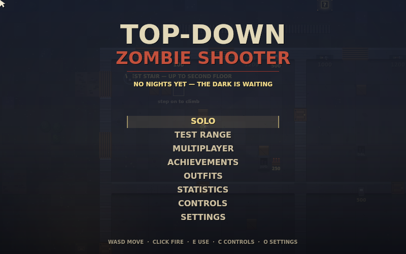
*Top-Down Zombie Shooter · история проекта*

Заметки докладчика

Эта презентация показывает не только список функций, но и путь: от маленького бункера и знакомой формулы Nacht der Untoten — к собственной многоэтажной игре с кооперативом, эвакуацией, мета-статистикой и большим ростером врагов. История проекта собрана по Git-истории, README и документации. Срез кода — коммит 227241d от 24 октября 2026 года.

---

## 02. Зомби-режим, который начинался как тайна

**01 · ИСТОКИ / CALL OF DUTY**

Nacht der Untoten задала простую цель: выдержать ещё одну волну — и не дать бункеру пасть.

- **11 ноября 2008** — Call of Duty: World at War выходит с бонусным режимом Zombies.
- **После кампании** — Секретная карта Nacht открывалась после миссии Downfall.
- **Одна задача** — Выживать в кооперативе, удерживая оборону против бесконечной орды.

**Ссылки:** [Call of Duty Wiki — Nacht der Untoten](https://callofduty.fandom.com/wiki/Nacht_der_Untoten) · [Nazi Zombies Wiki — Nacht der Untoten](https://nazizombies.fandom.com/wiki/Nacht_der_Untoten)

Заметки докладчика

Речь именно о Nacht der Untoten из Call of Duty: World at War. На старте это был скрытый режим выживания, а не отдельная сюжетная кампания: карту открывали после прохождения кампании. Главная сила формулы — в ясной цели, ограниченном пространстве и нарастающем давлении волн.

Источники:
Call of Duty Wiki — Nacht der Untoten: https://callofduty.fandom.com/wiki/Nacht_der_Untoten
Nazi Zombies Wiki — Nacht der Untoten: https://nazizombies.fandom.com/wiki/Nacht_der_Untoten

---

## 03. Nacht: маленький бункер, большой ритм

**01 · ИСТОКИ / ПРОСТРАНСТВО**

Три комнаты и несколько окон превращают маршрут в главный ресурс игрока.

- **Заброшенный аэродром** — Немецкий бункер — тесная арена, в которой легко потерять безопасную позицию.
- **Три комнаты** — Стартовая, Help Room и верхняя комната открываются по мере накопления очков.
- **Пять окон** — В стартовой комнате забитые проёмы делают оборону активным делом, а не укрытием.

**Ссылки:** [Call of Duty Wiki — Nacht der Untoten](https://callofduty.fandom.com/wiki/Nacht_der_Untoten)

Заметки докладчика

Nacht строится на понятной географии: центральное пространство, комнаты за дверями и окна, откуда проникают враги. Из-за малого масштаба игрок быстро понимает карту, но каждая открытая дверь расширяет и возможности, и число направлений, за которыми нужно следить.

Источники:
Call of Duty Wiki — Nacht der Untoten: https://callofduty.fandom.com/wiki/Nacht_der_Untoten

---

## 04. Три комнаты — три решения

**01 · ИСТОКИ / ЭКОНОМИКА**

Цена открытия меняет маршрут, а настенные покупки дают контроль над риском.

- **Стартовая** — Kar98k — 200 очков; M1A1 Carbine — 600.
- **Help Room** — Дверь — 1 000; Thompson и двуствольный дробовик — по 1 200.
- **Верхняя** — Дверь — 1 000; BAR и Trench Gun внутри; шкаф со снайперской винтовкой — 1 500.

**Ссылки:** [Call of Duty Wiki — Nacht der Untoten](https://callofduty.fandom.com/wiki/Nacht_der_Untoten)

Заметки докладчика

Цены помогают увидеть, почему очки в классическом режиме важны не только как счётчик. Открыть следующую зону, взять гарантированное оружие у стены или сохранить деньги ради другого шанса — это разные стратегии, доступные в одном небольшом здании.

Источники:
Call of Duty Wiki — Nacht der Untoten: https://callofduty.fandom.com/wiki/Nacht_der_Untoten

---

## 05. Очки превращают бой в экономику

**01 · ИСТОКИ / ОЧКИ**

Каждое столкновение становится выбором между текущей безопасностью и будущей покупкой.

- **Разные награды** — В исторической системе встречаются ступени +10, +60, +100 и +130 очков.
- **Куда потратить** — Двери, оружие и Mystery Box конкурируют за один и тот же запас.
- **Окна — пауза с пользой** — Пока орда не прорвала оборону, у игрока остаётся короткая работа между атаками.

**Ссылки:** [Call of Duty Wiki — Nacht der Untoten](https://callofduty.fandom.com/wiki/Nacht_der_Untoten)

Заметки докладчика

Вместо того чтобы приписывать каждому числу спорное действие, здесь показаны именно ступени очков, используемые в экономике режима. Суть для дизайна — вознаграждать участие в обороне и заставлять выбирать, куда вложить ограниченный запас.

Источники:
Call of Duty Wiki — Nacht der Untoten: https://callofduty.fandom.com/wiki/Nacht_der_Untoten

---

## 06. Mystery Box: заплатить за шанс

**01 · ИСТОКИ / СЛУЧАЙНЫЙ НАГРАДОЙ**

Вместо гарантированного ствола — короткая ставка на случайность и надежда на wonder weapon.

- **Фиксированная цена** — Один запуск коробки в Nacht стоит 950 очков.
- **Содержимое неизвестно** — Ящик выдаёт случайное оружие: игрок меняет предсказуемость на шанс.
- **Ray Gun** — Первое wonder-оружие превращает удачу в заметный скачок силы.

**Ссылки:** [Call of Duty Wiki — Nacht der Untoten](https://callofduty.fandom.com/wiki/Nacht_der_Untoten)

Заметки докладчика

Важно не смешивать историю разных карт: в Nacht der Untoten ящик находится в фиксированном месте и стоит 950 очков. Переезд коробки после появления плюшевого мишки относится к более позднему развитию серии.

Источники:
Call of Duty Wiki — Nacht der Untoten: https://callofduty.fandom.com/wiki/Nacht_der_Untoten

---

## 07. Четыре пауэр-апа меняют темп волны

**01 · ИСТОКИ / ПАУЭР-АПЫ**

Короткое событие может перевернуть плохую позицию — но лишь на время.

- **Max Ammo** — Пополняет боезапас и снимает давление нехватки патронов.
- **Insta-Kill** — Временно делает убийство зомби мгновенным.
- **Double Points · Nuke** — Удваивает заработок или очищает текущую орду; это четыре оригинальных бонуса Nacht.

**Ссылки:** [Call of Duty Wiki — Nacht der Untoten](https://callofduty.fandom.com/wiki/Nacht_der_Untoten)

Заметки докладчика

Оригинальные четыре бонуса Nacht — Max Ammo, Insta-Kill, Double Points и Nuke. Они задают темп короткими всплесками: пополнение ресурсов, ускоренное убийство, усиленная экономика и немедленное снятие давления.

Источники:
Call of Duty Wiki — Nacht der Untoten: https://callofduty.fandom.com/wiki/Nacht_der_Untoten

---

## 08. Формула росла после Nacht

**01 · ИСТОКИ / РАЗВИТИЕ СЕРИИ**

Знакомые элементы не все появились в первой карте: классика Zombies расширялась поэтапно.

- **Новые карты WaW** — Perks и переключатели питания пришли в последующих картах 2009 года.
- **Больше контроля** — Ловушки, Hellhounds и перемещающийся Mystery Box добавили новые ответы орде.
- **Der Riese** — Pack-a-Punch за 5 000 очков стал поздним шагом эволюции серии, не механикой исходной Nacht.

**Ссылки:** [Call of Duty Wiki — Nacht der Untoten](https://callofduty.fandom.com/wiki/Nacht_der_Untoten) · [Nazi Zombies Wiki — Nacht der Untoten](https://nazizombies.fandom.com/wiki/Nacht_der_Untoten)

Заметки докладчика

Это важное разграничение для рассказа об источнике вдохновения: Nacht дала базовую петлю и атмосферу, а многие механики, знакомые по более поздним Zombies, были добавлены в следующих картах World at War — Verrückt, Shi No Numa и Der Riese.

Источники:
Call of Duty Wiki — Nacht der Untoten: https://callofduty.fandom.com/wiki/Nacht_der_Untoten
Nazi Zombies Wiki — Nacht der Untoten: https://nazizombies.fandom.com/wiki/Nacht_der_Untoten

---

## 09. Взята формула — создан свой мир

**02 · СВОЯ ИГРА / КОНЦЕПЦИЯ**

2D survival-wave shooter в одном большом здании: от подвала до крыши, от первой волны до эвакуации.

- **Сохранить формулу** — Раунды, давление орды, ограниченную экономику и кооператив.
- **Сменить масштаб** — Вид сверху и вертикальное здание вместо копирования карты Nacht.
- **Своя подача** — Vanilla JS, Canvas, процедурная графика и синтезируемый звук.
- **Своя история** — Собственные имена, код, музыка и маршрут развития игры.

*Главное меню объединяет режимы, прогресс и настройки.*

Заметки докладчика

Переход от Call of Duty к проекту — не попытка пересобрать Nacht один к одному. Заимствована узнаваемая структура выживания: волны, ресурсы, покупки, усиления и совместная борьба. Затем эта структура переведена в другой масштаб и технический формат. Главный экран показывает сформировавшийся продукт: Solo, Test Range, Multiplayer, достижения, гардероб, статистику, управление и настройки.

---

## 10. Путь проекта — четыре волны изменений

**03 · ХРОНОЛОГИЯ / 02—24 ОКТЯБРЯ**

От рабочего прототипа до отполированного кооперативного survival-run за 23 дня истории Git.

- **02 окт** — Бункер, окна, очки, генератор, перки, коробка и крафт.
- **03—12 окт** — Три этажа, оптимизация, новые враги, музыка, LAN-кооп и Test Range.
- **15—17 окт** — Haunt, эвакуация, radio events, QA, достижения, музыка и мета-статистика.
- **22—24 окт** — Костюмы, Dash, Wardens, responsive UI, новые спрайты и полировка.

Заметки докладчика

Хронология собрана по 77 коммитам с 2 по 24 октября 2026 года и пяти pull request. Слайды дальше сначала идут по времени, а затем сводят актуальные на 24 октября системы в единое целое.

---

## 11. Первые сутки: от бункера к системам

**03 · ХРОНОЛОГИЯ / 02 ОКТЯБРЯ**

Рабочий прототип сразу соединяет геометрию, движение орды и первые цели прогрессии.

- **A / B / C / D** — Четыре зоны, 20 окон и настенные покупки собирают базовую арену.
- **Путь орды** — Dijkstra flow field направляет зомби к игроку.
- **Генератор и 8 перков** — Питание здания и постоянные бонусы добавляют долгосрочные решения.
- **Коробка и секреты** — Пять точек Mystery Box, Teddy Bear, семь пауэр-апов, верстак и четырёхдисковая пасхалка.

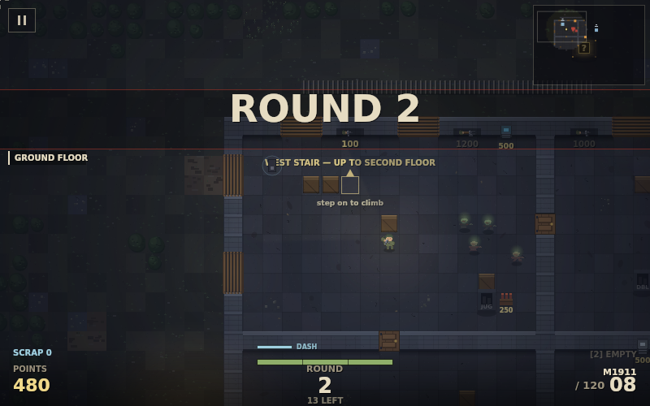
*Ранняя петля: ориентироваться, держать окна и открывать системы карты.*

Заметки докладчика

Первый playable build уже содержал четырёхкомнатный план, двадцать окон, покупки оружия у стены и навигацию орды через поле расстояний. В тот же день к циклу добавились генератор, восемь перков, Mystery Box в пяти возможных точках, Teddy Bear, семь пауэр-апов, верстак и четырёхдисковая пасхалка. Так прототип быстро получил не только арену, но и систему целей.

---

## 12. Pack-a-Punch, слоты и ловушки

**03 · ХРОНОЛОГИЯ / 02 ОКТЯБРЯ**

Ресурсы начинают усиливать не только игрока, но и саму арену.

- **Улучшение оружия** — Pack-a-Punch в радио-комнате стоит 5 000 очков.
- **Два ствола** — Оружие хранится в двух слотах; 1 / 2 / Q переключают выбор.
- **Защита карты** — Три ловушки по 500 очков; в орду добавлены Crawler и Shrieker.

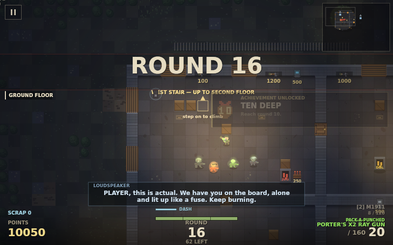
*Оружие, усиленное в Pack-a-Punch, и wonder-оружие в одном забеге.*

Заметки докладчика

Pack-a-Punch стоит 5 000 очков в комнате радио — это уже переосмысление механики, знакомой по более поздним картам Zombies. Одновременно появились два слота переносимого оружия, ловушки и новые роли врагов, которые заставляют по-другому распоряжаться пространством.

---

## 13. Бункер растёт вверх

**04 · КАРТА / 03—04 ОКТЯБРЯ**

Вместо отдельного этажа-зоны — единое здание, которое раскрывается вертикально.

- **72 × 50 клеток** — Единый план здания задаёт масштаб карты.
- **Три уровня** — Наземный бункер → казармы второго этажа → чердак и крыша.
- **Связи между этажами** — Лестницы и подъёмы добавляют маршруты, высоту и точки риска.

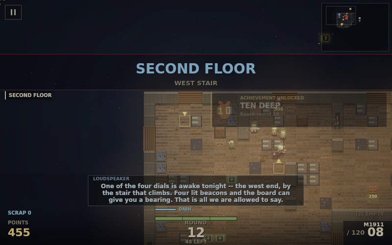
*Казармы и переходы на втором этаже.*

Заметки докладчика

В первые дни карта перестала быть плоским набором комнат. Здание стало трёхэтажным: подвал / наземный бункер, L-образные казармы и чердак с крышей. Лестницы и подъёмы соединяют уровни, а позднее крыша получает собственную роль в финале.

---

## 14. Враги начинают требовать разных ответов

**04 · ВРАГИ / 03—04 ОКТЯБРЯ**

Новые архетипы разрушают привычку решать каждую волну одним и тем же способом.

- **Helmeted · Napalm · Gasbag** — Броня, огонь и токсичная угроза меняют дистанцию и приоритет целей.
- **Miner · Mimic** — Новые типы добавляют неожиданность и отдельные роли в орде.
- **Field Medic · Amalgam** — Поддержка и слияние расширяют тактический состав врагов.

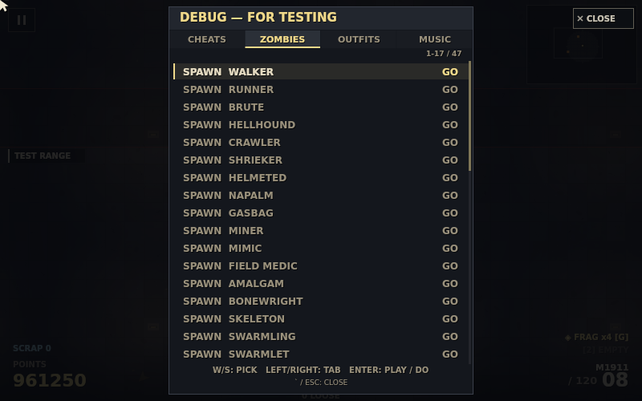
*Внутренний Zoo показывает рост и разнообразие ростера.*

Заметки докладчика

Первая крупная волна новых врагов добавила Helmeted, Napalm и Gasbag, затем Miner, Mimic, Field Medic и Amalgam / Fusion. Это ранний переход от просто растущего количества зомби к столкновениям с разными ролями.

---

## 15. Оптимизация — тоже обновление

**04 · ИНЖЕНЕРИЯ / 03—04 ОКТЯБРЯ**

Раунд 5 обнаружил не балансную проблему, а утечку памяти в горячем пути рендера.

- **Диагноз** — glowSprite() создавала 12 canvas и градиентов на кадр — около 46 МБ/с.
- **Исправление** — Half-res lighting, кэш текста HUD и quality governor сняли лишнюю работу.
- **Результат** — Длинный забег получил более стабильный рендер и запас по качеству.

*Световой слой остаётся частью визуального языка, но больше не пересоздаётся без контроля.*

Заметки докладчика

Падение производительности проявлялось примерно к пятому раунду. Причина была в glowSprite(): двенадцать canvas и градиентов создавались каждый кадр, около 46 мегабайт временных данных в секунду. Решение сочетало уменьшенную разрешающую способность освещения, кэш текста HUD и регулятор качества.

---

## 16. Атмосфера стала реагировать на игру

**05 · ЗВУК / 09 ОКТЯБРЯ**

Фоновая музыка и акустика комнаты перестали быть неподвижным слоем.

- **Три музыкальных слоя** — Адаптивный WebAudio-score меняет плотность и ощущение сцены.
- **Реверберация** — Комната получает собственный акустический оттенок.
- **Всё в коде** — Звук синтезируется WebAudio без внешних музыкальных файлов.

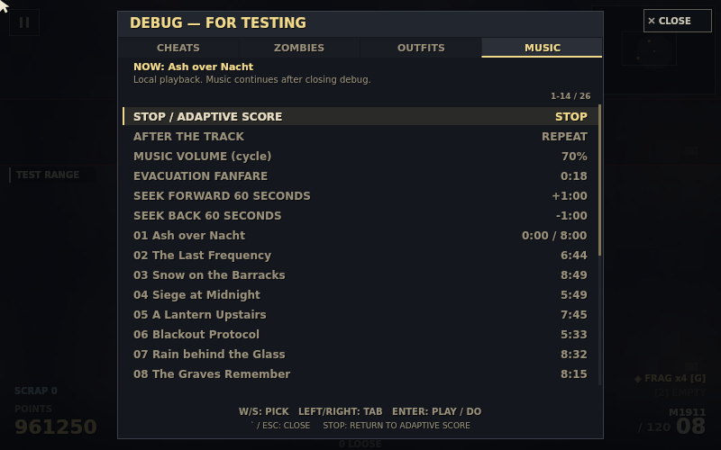
*Внутренняя музыкальная библиотека и управление воспроизведением.*

Заметки докладчика

В этот этап вошёл адаптивный трёхслойный WebAudio-score и реверберация комнат. Это не просто набор файлов, проигрываемых по очереди: музыкальная система и звуковая среда проектируются внутри игры.

---

## 17. Кооп работает по локальной сети

**05 · КООП / 09—12 ОКТЯБРЯ**

Один игрок запускает симуляцию, остальные присоединяются и получают состояние мира.

- **WebSocket relay** — Связь без сторонних зависимостей; сервер пересылает сообщения комнаты.
- **20 снимков в секунду** — Хост симулирует игру и отправляет гостям сетевые snapshots.
- **12 игроков** — Пятибуквенные комнаты поддерживают вход посреди раунда.

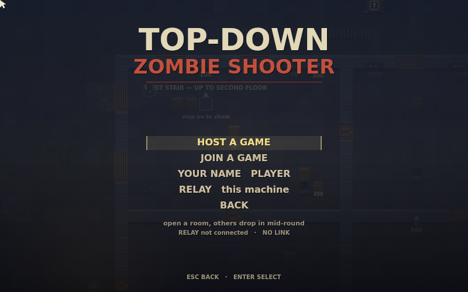
*Хост и присоединение к комнате доступны из меню.*

Заметки докладчика

Кооператив строится на простом релейном сервере: хост остаётся авторитетом симуляции, а relay знает только комнаты и участников. Снимки мира отправляются 20 раз в секунду; комнату можно присоединить по пятибуквенному коду, в том числе посреди игры.

---

## 18. Телефон становится полноценной платформой

**05 · ДОСТУПНОСТЬ / 09—12 ОКТЯБРЯ**

Экранные стики и кнопки появились вместе с переосмыслением масштаба интерфейса.

- **Слева — движение** — Виртуальный стик управляет перемещением.
- **Справа — бой** — Отдельные элементы управления отвечают за прицеливание и действия.
- **Настройка режима** — Сенсорная панель включается автоматически и подстраивается под экран.

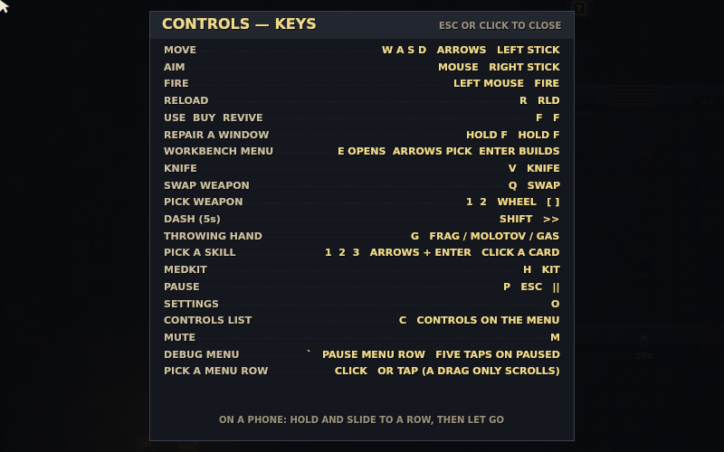
*Экранная схема помогает освоить клавиши и сенсорные действия.*

Заметки докладчика

Мобильный режим — это не только добавление джойстика поверх Canvas. Одновременно появились отдельные сенсорные элементы и переоценка плотности меню, чтобы на телефоне можно было двигаться, целиться и выполнять действия без мыши.

---

## 19. Отделение этажей и инструменты отладки

**05 · ИНСТРУМЕНТЫ / 09—12 ОКТЯБРЯ**

Чем сложнее мир, тем важнее видеть, что именно делает каждая система.

- **Изоляция эффектов** — Эффекты отделяются по этажам, чтобы переход не смешивал визуальные слои.
- **Интерактивная среда** — Мебель получает физические границы, а освещение — отдельный фильтр.
- **Controls и Debug** — Системные панели ускоряют настройку, проверку и поиск проблем.

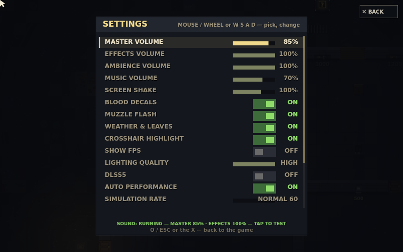
*Параметры графики, управления и удобства вынесены в отдельную панель.*

Заметки докладчика

Параллельно с кооперативом усилились инструменты и сама карта: добавлена изоляция эффектов по этажам, твёрдая мебель, световой фильтр, а также панели Controls и Debug. Они дали разработчику прямой способ проверять большой набор систем.

---

## 20. Арсенал вырос до 31 оружия

**05 · БОЙ / 09—12 ОКТЯБРЯ**

Три волны оружейных изменений расширили выбор от простых стеновых покупок до особых стволов.

- **Разные профили** — Оружие отличается темпом стрельбы, магазином, перезарядкой и ролью.
- **Два переносимых слота** — Выбор между оружием в руках остаётся частью стратегии забега.
- **Пакетный рост** — Вторая и третья волны довели каталог до 31 единицы.

*Наглядный итог цепочки: купить, выбрать, улучшить и использовать.*

Заметки докладчика

К 12 октября проект прошёл через вторую и третью волны оружия и достиг 31 вида. Важно, что это не только коллекция названий: оружие взаимодействует со слотами, перезарядкой, покупками и Pack-a-Punch.

---

## 21. Zoo и Test Range дают безопасную проверку

**05 · ПРОВЕРКА / 09—12 ОКТЯБРЯ**

Ростер и баланс удобнее исследовать там, где игроку не мешает очередная волна.

- **Bonewright · Swarmling · Jammer** — Новые противники получают собственные записи в каталоге Zoo.
- **Test Range** — Полигон позволяет проверять оружие и реакцию на цель отдельно от обычного забега.
- **36 достижений** — Долгие цели и события получают отдельный каталог.

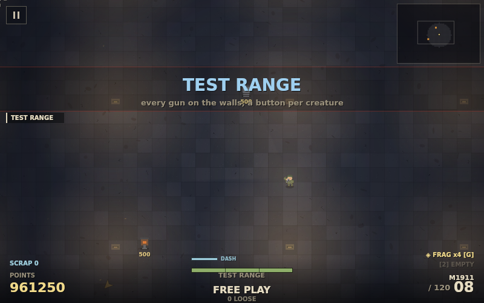
*Test Range отделяет проверку оружия от живого survival-забега.*

Заметки докладчика

В этот отрезок добавились Bonewright, Swarmling и Jammer, вкладка Zoo для просмотра противников, Test Range на отдельном полигоне и 36 достижений. Тренировочный режим делает итерацию по оружию и врагам воспроизводимой.

---

## 22. Верстак 2.0: крафт становится полезным выбором

**06 · ВЕРСТАК / 15 ОКТЯБРЯ**

Новые рецепты должны не просто существовать, а закрывать конкретную потребность забега.

- **Контракт useful()** — Рецепт учитывает, полезен ли предмет в текущем состоянии игрока.
- **Medkit и Armour Plate** — Лечение и запас прочности дают ответы на разные угрозы.
- **Steel Shutters** — Усиленные ставни превращают scrap в долгосрочную оборону окон.

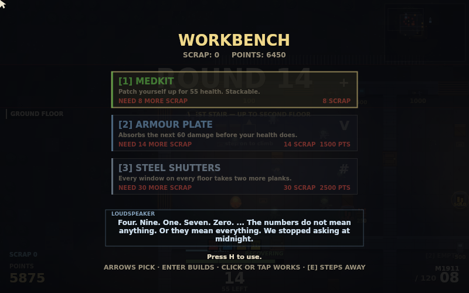
*Верстак: очки и scrap превращаются в решения о выживании.*

Заметки докладчика

Вторая версия чердачного верстака добавила контракт полезности для рецептов и три предмета: Medkit, Armour Plate и Steel Shutters. В том же этапе появился watchdog для гостевого входа, чтобы не зависать бесконечно при неудачном подключении.

---

## 23. The Haunt — особая ночь внутри забега

**06 · РАУНД / 15 ОКТЯБРЯ**

Отдельная волна получает собственную палитру угроз, а не просто повышенное здоровье врагов.

- **Восемь образов** — Totem Bearer, Mourner, Wraith и Snowman.
- **Ещё четыре роли** — Arsonist, Witch, Shocker и Knight расширяют ночной roster.
- **Событие с характером** — Haunt обозначает отдельный ритм и визуальную тональность волны.

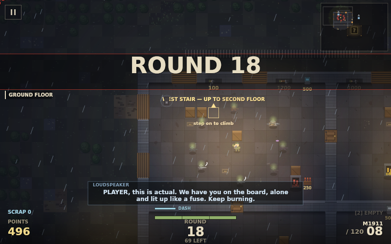
*Визуальный язык Haunt выделяет особую встречу.*

Заметки докладчика

The Haunt Round добавила восемь новых типов: Totem Bearer, Mourner, Wraith, Snowman, Arsonist, Witch, Shocker и Knight. Эта порция стала тематическим событием внутри общей системы раундов.

---

## 24. Погода и громкоговоритель оживляют карту

**06 · АТМОСФЕРА / 15 ОКТЯБРЯ**

Здание начинает звучать так, будто у него есть прошлое и кто-то всё ещё наблюдает.

- **Storm и Fog** — Гроза и туман меняют атмосферу сцены.
- **Loudspeaker** — Громкоговоритель передаёт короткие сообщения и фрагменты контекста.
- **Мир отвечает** — Погода и радио создают паузы и контраст между боями.

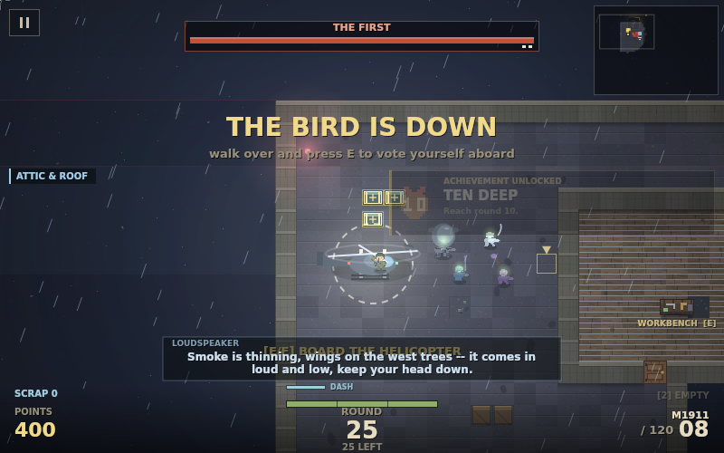
*Дождь, радио и крыша связывают игровую механику с настроением.*

Заметки докладчика

С темой Haunt пришли Storm и Fog, а также Loudspeaker с короткими репликами. Это подача атмосферы и намёков на историю — без вынесения мира в длинные кат-сцены.

---

## 25. Крыша становится финальной целью

**06 · ФИНАЛ / 16 ОКТЯБРЯ**

На 25-м раунде выживание получает вариант завершиться общей эвакуацией.

- **Условие** — Дойти до Round 25 и активировать четыре маяка.
- **Зелёный фальшфейер** — После сигнала начинается двухминутное ожидание вертолёта.
- **Решение команды** — В кооперативе посадка запускается по голосованию большинства.

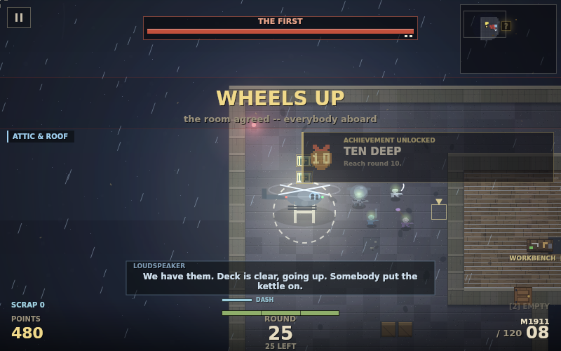
*EVACUATED — новая концовка забега, а не просто экран поражения.*

Заметки докладчика

Финал не обрывает игру автоматически: игроки доходят до раунда 25, активируют четыре маяка, подают зелёный сигнал и выдерживают две минуты до вертолёта. В кооперативе итог зависит от большинства голосов, а успешное завершение получает статус EVACUATED.

---

## 26. Радио и ящики снабжения связывают раунды

**06 · СЮЖЕТ / 16 ОКТЯБРЯ**

Между атаками появляются маленькие задачи, которые поддерживают долгую сессию.

- **Радиосообщения** — Передачи раскрывают тревожный контекст карты короткими фрагментами.
- **Care Packages** — События по радио могут направить игроков к ящикам снабжения.
- **Починка на крыше** — За 25 scrap можно восстановить радио и получать поставки каждые два раунда.

*Системные сообщения и задачи появляются прямо внутри игрового мира.*

Заметки докладчика

Радио стало не только источником атмосферы. Появились передачи и care packages, а починка радио на крыше за 25 единиц scrap запускает регулярные поставки раз в два раунда. Так exploration получает практическую награду.

---

## 27. Кооп получает правила спасения и командного движения

**06 · КООП / 16 ОКТЯБРЯ**

Сеть — это не только соединение: нужны понятные состояния, сроки и способы помочь.

- **Bleed-out: 60 секунд** — Сбитый игрок получает время на помощь команды.
- **Возрождение: 10 / 5 секунд** — Канал удержания длится 10 секунд или 5 с Quick Revive.
- **След игрока: 45 секунд** — Кооп-след направляет flow field орды к актуальному движению команды.

*Командные правила встроены в основной цикл выживания.*

Заметки докладчика

В кооперативе появились 60-секундное окно bleed-out, 10-секундное возрождение (5 секунд с Quick Revive), а также след присутствия игрока длительностью 45 секунд, влияющий на поле движения орды. Это добавляет совместную навигацию, а не только совместный огонь.

---

## 28. Аудит находит ошибки до следующего расширения

**07 · КАЧЕСТВО / 16—17 ОКТЯБРЯ**

Перед новым контентом проект проходит отдельный цикл безопасности и регрессии.

- **11 групп багов** — Исправлены проблемы сетевого состояния, управления, прогресса и интерфейсов.
- **20 новых тестов** — Регрессии закреплены автоматическими проверками.
- **48 harness-сценариев** — К ним добавлены проверки длительного запуска и сетевых случаев.

Заметки докладчика

QA/security-аудит PR #4 исправил одиннадцать групп ошибок, добавил двадцать регрессионных тестов и довёл исторический набор harness-сценариев до 48. Отдельная 90-секундная проверка помогает заметить проблемы, проявляющиеся не на первом кадре.

---

## 29. Достижения получают собственный пиксельный язык

**07 · ПРОГРЕСС / 17 ОКТЯБРЯ**

36 долгих целей становятся видимой частью интерфейса, а не скрытыми флагами.

- **Полный набор** — Для всех 36 достижений созданы пиксельные значки.
- **Связь с прогрессом** — Игрок видит, что открыл и какое условие ещё впереди.
- **Фундамент гардероба** — Часть наград за достижения позже открывает образы персонажа.

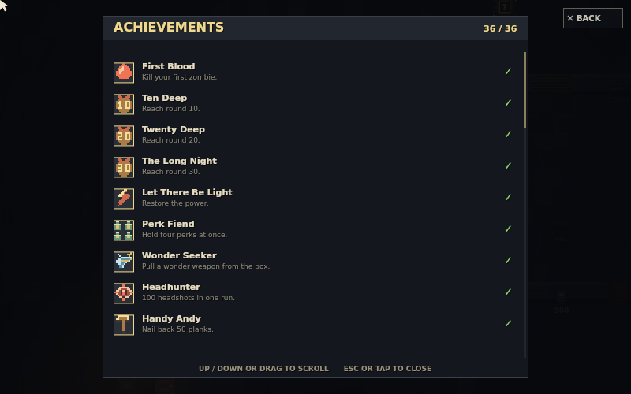
*36 достижений получили уникальную пиксельную подачу.*

Заметки докладчика

В этой итерации все 36 достижений получили пиксельные иконки. Система связывает цели забега с интерфейсом, а позднее становится источником разблокировки десяти образов персонажа.

---

## 30. В игре появляется своя музыкальная библиотека

**07 · ЗВУК / 17 ОКТЯБРЯ**

Музыка проектируется как процедурная система, а не набор внешних аудиофайлов.

- **20 саундтреков** — Каждый состоит из 128 тактов и восьми частей.
- **2 ч 22 мин 34 с** — Суммарная длительность каталога при полном прослушивании.
- **Listening room** — Музыку можно исследовать отдельно, а система поддерживает смену состояния.

*Каталог показывает треки и позволяет управлять воспроизведением.*

Заметки докладчика

К 17 октября в игре было двадцать процедурных WebAudio-треков. Каждый описан как 128 тактов, разделённых на восемь частей; суммарно библиотека занимает 2 часа 22 минуты 34 секунды. Listening room позволяет тестировать музыку отдельно от забега.

---

## 31. Финальный экран превращается в отчёт о забеге

**07 · ИТОГИ / 17 ОКТЯБРЯ**

Игра запоминает не только победу или поражение, но и то, как игрок к ним пришёл.

- **22 строки итогов** — Раунд, убийства, попадания, очки, scrap, урон, крафт и помощь команде.
- **Один забег — одна запись** — Смерть, эвакуация и выход фиксируют завершённый run.
- **Разные концовки** — Экран EVACUATED сохраняет отдельную отметку об эвакуации.

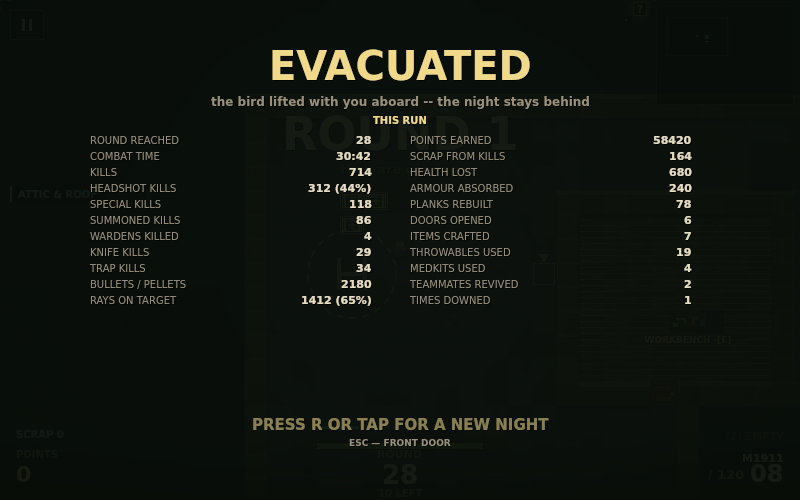
*Личный ledger превращает забег в набор конкретных результатов.*

Заметки докладчика

Итоговый экран получил 22 строки ledger: раунд, убийства, точность, попадания в голову, очки, scrap, полученный урон, баррикады, крафты, ревивы и другие показатели. Сессия фиксируется при завершении, а эвакуация не смешивается с обычной смертью.

---

## 32. Навыки забега: добавлены, но пока отключены

**07 · НАВЫКИ / 17 ОКТЯБРЯ**

Важный статус проекта: система существует, однако не входит в активный цикл забега.

- **16 карточек** — Пул run skills подготовлен для выбора каждые пять волн.
- **Только на один забег** — Навыки временные и не заменяют перки, приобретаемые на карте.
- **Флаг выключен** — SKILLS_ENABLED = false: карты, HUD и эффекты сейчас не активны.

Заметки докладчика

Навыки забега нельзя описывать как включённую функцию. Архитектура, карточки и сетевой перенос реализованы, но одна настройка SKILLS_ENABLED оставлена в false. Поэтому в текущей версии игрок не получает карточки и HUD не показывает навыки.

---

## 33. Статистика переживает отдельную ночь

**07 · МЕТА-ПРОГРЕСС / 17 ОКТЯБРЯ**

Все завершённые забеги пополняют локальный дневник игрока.

- **localStorage** — Данные хранятся на устройстве в ключе ndu.lifetime.v1.
- **Сводка и детали** — Всего 24 показателя: ночи, убийства, точность, scrap, урон и помощь.
- **Практика отдельно** — Забег на Test Range не попадает в постоянную статистику.

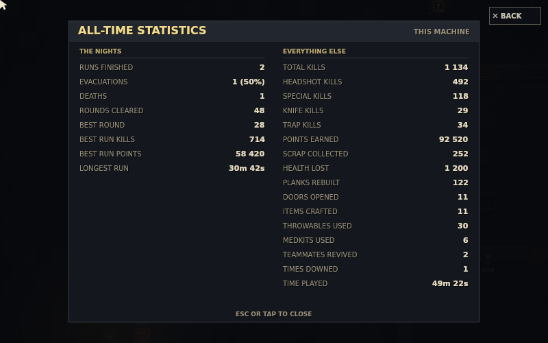
*All-time statistics разделяет историю ночей и боевые показатели.*

Заметки докладчика

Долгоживущая статистика добавлена под ключом ndu.lifetime.v1. Смерть, эвакуация и уход в меню сохраняются ровно один раз; тренировочный режим исключён. Это локальный дневник, не серверная таблица лидеров.

---

## 34. Десять образов добавляют характер и лёгкие бонусы

**08 · ПЕРСОНАЖ / 22 ОКТЯБРЯ**

Косметическая прогрессия привязана к достижениям, а не к отдельной экономике.

- **10 outfits** — Образы открываются через достижения и доступны в гардеробе.
- **Бонусы сдержанные** — Например, скорость, перезарядка, здоровье или добыча scrap.
- **Проверяемый статус** — Каждый вариант показывает, открыт ли он и что делает.

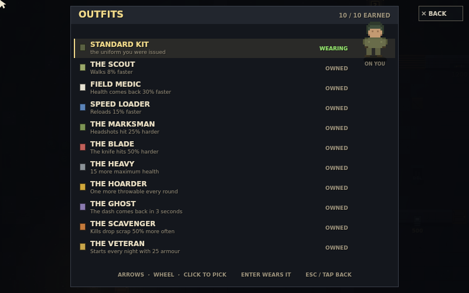
*Гардероб показывает условие и эффект каждого образа.*

Заметки докладчика

Обновление 22 октября добавило десять образов, открываемых достижениями. Важно показать, что гардероб не только визуальный: у некоторых нарядов есть небольшой игровой бонус, описанный прямо в списке.

---

## 35. Dash и масштаб экрана подстраивают игру под игрока

**08 · ДВИЖЕНИЕ / 22 ОКТЯБРЯ**

Короткий рывок добавляет мобильности, а картинка больше не обязана быть 800 × 500.

- **Shift · Dash** — Рывок примерно на одну клетку; повторная готовность через 5 секунд.
- **Динамический viewport** — Экран получает форму телефона, ноутбука или широкого монитора.
- **PICTURE SIZE** — Четыре шага масштаба позволяют выбрать читаемость и обзор.

*Размер изображения выбирается внутри игры.*

Заметки докладчика

Сначала появился Dash с пятиисекундным перезарядом, затем обновился viewport: вместо жёстких чёрных полос игра показывает больше мира по вертикали или горизонтали. Настройка PICTURE SIZE отдельно меняет масштаб всей сцены.

---

## 36. Вторая волна существ добавляет новые роли

**08 · РОСТЕР / 22—23 ОКТЯБРЯ**

Противники отличаются не только видом: они создают разные задачи для оружия и позиции.

- **Beekeeper · Weaver** — Рой и паутина добавляют угрозы контроля пространства.
- **Bone Archer · Bulwark · Widow** — Дистанция, защита и яд заставляют менять приоритет целей.
- **Drummer · Sapper · Porter · The First** — Поддержка, давление и уникальная роль босса завершают новую волну.

*Zoo помогает сверять новые силуэты и поведение врагов.*

Заметки докладчика

Вторая крупная волна существ включила Beekeeper, Weaver, Bone Archer, Bulwark, Widow с отдельной фиолетовой полосой яда, Drummer, Sapper, Porter и The First. Это расширение ростера, а не замена прежних врагов.

---

## 37. Девять Wardens превращают каждые пять волн в проверку

**08 · БОССЫ / 23 ОКТЯБРЯ**

Босс — событие, которое задаёт ритм всей следующей части забега.

- **Раунды 10–50** — Warden появляется на каждом пятом раунде в этом диапазоне.
- **Цикл продолжается** — После 50-го раунда набор повторяется.
- **Сложнее с циклом** — При новом цикле здоровье увеличивается ещё на 35%.

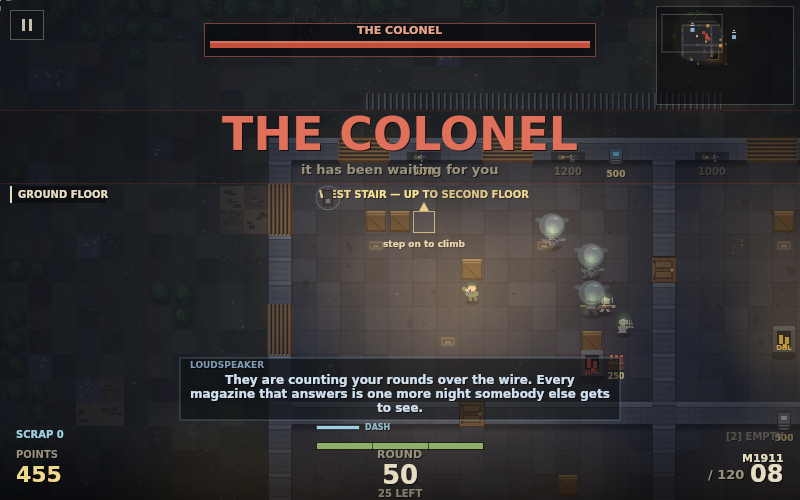
*Boss Warden отмечен отдельной полосой здоровья.*

Заметки докладчика

В игре девять вариантов Boss Warden; встреча происходит каждые пять раундов — 10, 15, 20 и так далее до 50. После циклического возврата здоровье получает прибавку 35 процентов, чтобы серия не обнуляла напряжение.

---

## 38. Телефонный интерфейс: меньше промахов и случайных нажатий

**08 · МОБИЛЬНЫЙ UI / 23 ОКТЯБРЯ**

Каждое меню проверено на узком экране, а жест прокрутки отделён от выбора.

- **BACK / CLOSE** — Полноэкранные панели получают видимую кнопку выхода.
- **Пауза сверху слева** — Кнопка не конфликтует с правой мини-картой и краями экрана.
- **Flick ≠ tap** — Прокрутка списка не должна случайно выбрать строку или переключить настройку.

*Управление и выход из панели остаются видимыми на маленьком экране.*

Заметки докладчика

В responsive-проходе появились кнопки BACK / CLOSE, пауза в верхнем левом углу, разделение flick и tap и тесты menutext на восьми размерах экрана. Это снижает число случаев, когда интерфейс технически виден, но физически неудобен.

---

## 39. Спрайты перерисованы, тяжёлые ресурсы прогреты заранее

**08 · ВИЗУАЛ / 23—24 ОКТЯБРЯ**

Последние изменения улучшают читаемость и убирают заметное ожидание при первом клике.

- **Новые силуэты** — Перерисованы костяные враги, броня Knight, лук и барабан.
- **Предзагрузка** — Range и спрайты готовятся заранее, а не в момент первого показа.
- **124 → 7 мс** — Время первого клика сократилось после pre-warm оптимизации.

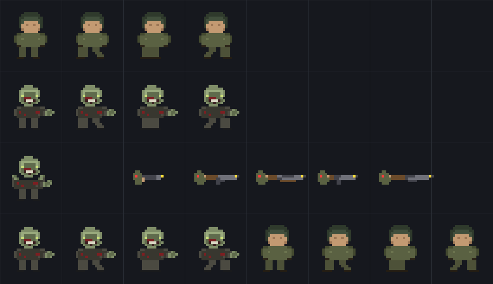
*Процедурные спрайты строятся из небольших пиксельных блоков.*

Заметки докладчика

В конце истории улучшились и искусство, и отклик: перерисованы костяные скелеты, броня Knight, спрайты лука и барабана. Предварительный прогрев Test Range и спрайтов снизил задержку первого клика примерно со 124 до 7 миллисекунд.

---

## 40. Финальный проход связывает звук, эффекты и кооп

**08 · ПОЛИРОВКА / 24 ОКТЯБРЯ**

Небольшие правки делают готовую игру последовательнее на всех этажах и экранах.

- **Звук** — Аудио получает восстановление после ошибок, интерактивный статус и ротацию музыки меню/забега.
- **Эффекты** — Дропы и дым изолируются по этажам; детали костюмов получают подписи.
- **LAN** — Сетевые интерфейсы подписаны понятнее, чтобы выбрать нужный адрес.

*Музыкальный интерфейс стал частью диагностики и повседневного использования.*

Заметки докладчика

Последний зафиксированный коммит 227241d завершил серию небольших, но важных улучшений: восстановление аудио, интерактивный статус-бар, вращение музыкальных тем, изоляция дропов и дыма по этажам, уточнение подписей костюмов и адресов LAN.

---

## 41. Архитектура: маленькое ядро, много игровых модулей

**09 · АРХИТЕКТУРА / ПОД КАПОТОМ**

Проект остаётся vanilla ES modules: без сборщика и без runtime-зависимостей.

- **30 модулей** — Игровые системы разделены на файлы в src/.
- **HTML Canvas** — Canvas отвечает за 2D-рендер, UI и пиксельную сцену.
- **Нулевые зависимости** — Статический сервер запускает проект напрямую и может обслуживать LAN-кооп.

Заметки докладчика

В текущем исходном дереве находится тридцать vanilla ES-модулей игры, а сервер написан отдельно в server.mjs. Внешней сборки нет: браузер загружает ES-модули, HTML и CSS непосредственно.

---

## 42. Графика и звук рождаются внутри кода

**09 · ГРАФИКА / ЗВУК**

Проект не опирается на пакет внешних ассетов: визуальный стиль и звук процедурные.

- **Пиксель-арт** — Персонажи, враги, оружие и эффекты описаны процедурно.
- **WebAudio** — Музыка и звуковые слои генерируются в браузере.
- **Лёгкий старт** — В репозитории нет отдельного каталога игровых текстур и аудиофайлов.

*Фрагмент набора персонажей и оружия, отрисованного из кода.*

Заметки докладчика

Процедурный подход связывает художественный стиль и архитектуру: спрайты создаются кодом, а WebAudio синтезирует музыкальные и звуковые материалы. Sprite sheet на иллюстрации — один из результатов такого процесса.

---

## 43. Бой строится на выборе ресурса

**09 · БОЕВАЯ ПЕТЛЯ**

Забег связывает четыре решения: чем стрелять, что улучшать, где держаться и когда тратить.

- **31 оружие · 2 слота** — Игрок собирает пару стволов и выбирает момент переключения.
- **8 перков · 7 бонусов** — Покупки и короткие усиления меняют экономику следующей волны.
- **Крафт · ловушки** — Очки и scrap работают на игрока, оборону и карту.

Заметки докладчика

В этой версии боевой цикл опирается на 31 вид оружия, два переносимых слота, восемь перков и семь power-up. Крафт и ловушки добавляют отдельное применение scrap и очков.

---

## 44. Три этажа — одна связанная арена

**09 · ПРОСТРАНСТВО / МАРШРУТЫ**

Вертикальность создаёт опасные переходы и даёт игроку пространство для выбора маршрута.

- **Ground floor** — Бункер и основная стартовая экономика.
- **Second floor** — Казармы и промежуточные маршруты через лестницы.
- **Attic & roof** — Чердак, верстак, радио и площадка финальной эвакуации.

*Лестницы связывают уровни в один маршрут.*

Заметки докладчика

Карта сохраняет единый масштаб — 72 на 50 клеток — и включает наземный уровень, L-образный второй этаж, чердак и крышу. Верхний уровень не только декорация: там находятся верстак, радио и эвакуация.

---

## 45. Орда читает позицию, а не только расстояние

**09 · AI ОРДЫ**

Поле пути превращает перемещение игрока в часть поведения врагов.

- **Dijkstra flow field** — Зомби движутся по общему полю стоимости к текущей цели.
- **Карта меняет путь** — Окна, двери и этажи создают разные точки подхода.
- **Кооп-след** — 45-секундный след игрока помогает направлять орду к группе.

Заметки докладчика

Базовый прототип уже использовал Dijkstra flow field. Позже эта система стала учитывать среду и кооперативный след игрока: позиция команды влияет на то, откуда и по каким маршрутам приходит давление.

---

## 46. Кооп не требует отдельного игрового сервера

**09 · СЕТЬ / LAN**

Хост запускает симуляцию, а relay передаёт события и состояние между участниками.

- **Zero-dependency relay** — Связь работает через WebSocket и встроенный server.mjs.
- **До 12 игроков** — Игровая комната остаётся локальной; сервер не управляет боем.
- **Сеть как сервис** — Гости могут войти по коду и присоединиться посреди раунда.

*Лобби описывает комнату и статус relay.*

Заметки докладчика

Сетевой слой намеренно прост: сервер не знает, как работают зомби, оружие или очки. Хост является авторитетом мира, а relay поддерживает комнату, пересылку и передачу роли хоста при отключении.

---

## 47. Проверки встроены в темп разработки

**09 · НАДЁЖНОСТЬ / QA**

Тесты закрывают не только функции, но и границы серверной поверхности.

- **20 регрессионных проверок** — Зафиксированы ошибки, найденные аудитом.
- **48 harness suites** — Сценарии покрывают бой, кооп, этажи и долгие прогоны.
- **Строгий whitelist** — Сервер отдаёт только игровые публичные файлы и презентацию.

Заметки докладчика

К моменту среза проект использует автоматические тесты и тестовый harness. Встроенный HTTP-сервер специально обслуживает ограниченный список файлов: исходник сервера, package.json и .git не должны становиться публичными ресурсами.

---

## 48. От первой двери — к вертолёту на крыше

**09 · ЗАБЕГ / ПОЛНЫЙ ЦИКЛ**

Каждая механика расширяет одну непрерывную петлю выживания.

- **1 · Разогнаться** — Получать очки, удерживать окна, открывать двери и выбирать оружие.
- **2 · Перестроиться** — Покупать перки, использовать крафт, менять этаж и отвечать на тип врага.
- **3 · Завершить** — Продержаться до 25-го раунда, включить четыре маяка и голосовать за эвакуацию.

*Риск не исчезает после запуска: команде нужно выдержать ожидание вертолёта.*

Заметки докладчика

Полная петля связывает краткосрочную оборону, рост возможностей и решение об окончании забега. Эвакуация — необязательный финал, который становится доступен после раунда 25 и запускается через четыре маяка, сигнал и ожидание команды.

---

## 49. Итоговый срез: сколько системы собрано

**10 · СРЕЗ / 24 ОКТЯБРЯ 2026**

От одного бункера — к игре с большим ростером и несколькими длинными целями.

- **44 типа врагов** — Включая девять Wardens и несколько тематических волн.
- **31 оружие · 8 перков** — Основной боевой выбор и постоянные усиления.
- **36 достижений · 10 образов** — Цели забега связаны с косметической прогрессией.
- **20 саундтреков** — Процедурная библиотека вместе с радио и адаптивной подачей.

*Разнообразие контента работает поверх одной понятной survival-петли.*

Заметки докладчика

На 24 октября 2026 года в проекте 44 типа врагов, включая девять Wardens, 31 оружие, восемь перков, семь пауэр-апов, 36 достижений, десять образов и двадцать процедурных саундтреков. Run skills подготовлены, но выключены флагом SKILLS_ENABLED.

---

## 50. От вдохновения — к собственной ночи

**11 · ЗАКЛЮЧЕНИЕ / ИСТОЧНИКИ**

Nacht дала отправную точку; эволюцию определили решения самого проекта.

- **Формула** — Волны, экономика и давление орды стали основой, а не пределом.
- **Рост** — Карта, кооп, качество, звук и прогрессия добавлялись итерациями.
- **Что дальше** — В docs/IDEAS.md отмечены планы — они не включены в текущий срез.

**Ссылки:** [Call of Duty Wiki — Nacht der Untoten](https://callofduty.fandom.com/wiki/Nacht_der_Untoten) · [Nazi Zombies Wiki — Nacht der Untoten](https://nazizombies.fandom.com/wiki/Nacht_der_Untoten) · [Репозиторий и документация проекта](https://github.com/AtesiT/zombies-game-cod) · [История обновлений: PR #1–#5](https://github.com/AtesiT/zombies-game-cod/pulls)

Заметки докладчика

Итог: жанровое вдохновение обернулось самостоятельной игрой, а не копией конкретной карты. История завершена на актуальном срезе 24 октября 2026 года. Дальнейшие предложения в IDEAS.md — это roadmap, а не выполненные функции. Источники: Call of Duty Wiki и Nazi Zombies Wiki по Nacht; репозиторий AtesiT/zombies-game-cod, README, docs/PERF.md, docs/MUSIC.md, docs/QA_REPORT.md, docs/IDEAS.md; история PR #1–#5.

Источники:
Call of Duty Wiki — Nacht der Untoten: https://callofduty.fandom.com/wiki/Nacht_der_Untoten
Nazi Zombies Wiki — Nacht der Untoten: https://nazizombies.fandom.com/wiki/Nacht_der_Untoten
Репозиторий и документация проекта: https://github.com/AtesiT/zombies-game-cod
История обновлений: PR #1–#5: https://github.com/AtesiT/zombies-game-cod/pulls

---
